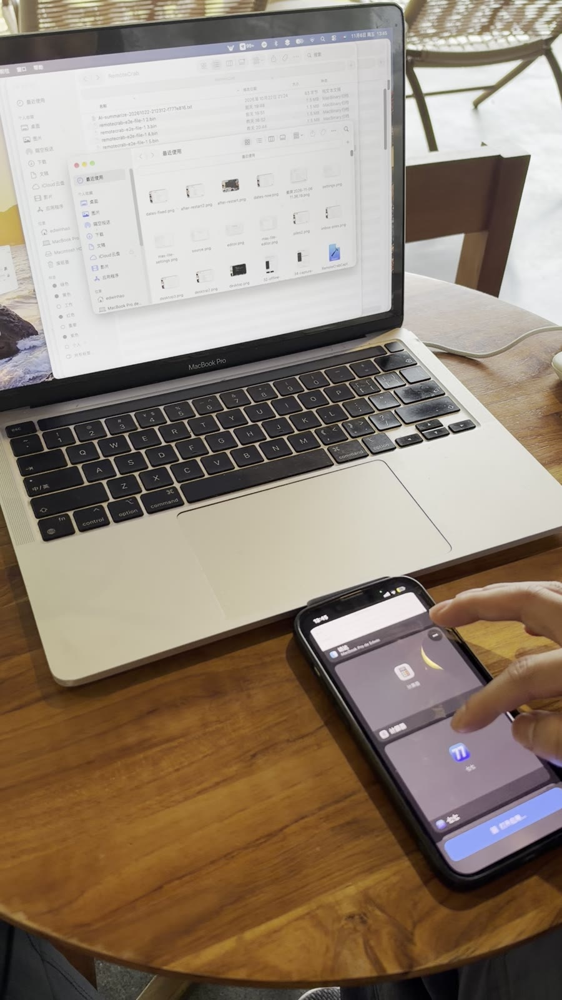

# RemoteCrab

**Stop buying webcams. The iPhone in your drawer already is one.**




RemoteCrab turns an iPhone or iPad into a **camera, microphone, trackpad and
keyboard** for your Mac — over your own Wi-Fi, with no account, no cloud
round-trip and no analytics. The Mac half can also share your screen to **any
modern browser**: one link, no account, no certificate to accept, so a Windows PC
or a friend's laptop can watch and drive it without installing anything.

> This repository is the **download and documentation** page. It contains no
> source code — the application's source is not published. The licence below
> covers the documents in this repository.

## Download

| Platform | Requirement | Link |
|---|---|---|
| iPhone / iPad | iOS 17 or newer | [App Store](https://apps.apple.com/app/id6811599153) |
| Mac | macOS 26 or newer | [RemoteCrab.dmg](https://vgoapp.com/downloads/RemoteCrab.dmg) — Developer ID signed and notarized |
| Windows | Windows 10 1809 or newer (virtual camera needs Windows 11 22H2+) | [RemoteCrab-Windows-setup.zip](https://vgoapp.com/downloads/RemoteCrab-Windows-setup.zip) |

Both desktop builds update themselves in place.

### Mac, via Homebrew

```bash
brew tap edwin-hao-ai/remotecrab
brew trust --cask edwin-hao-ai/remotecrab/remotecrab
brew install --cask edwin-hao-ai/remotecrab/remotecrab
```

The `trust` step is Homebrew's own guard for third-party taps; without it the install
refuses to load the cask. If your Homebrew predates `brew trust`, use the DMG above
instead. `brew install --cask remotecrab` from the official repository is not available
yet: it requires 225 stars for a self-submitted cask.

## What it does

- **Camera** — 1080p at 30 fps, H.264 over your local network, and a virtual
  camera so Zoom, Meet, FaceTime and QuickTime pick it as a normal camera.
- **Microphone** — the phone's mic as a system input on the Mac.
- **Trackpad and keyboard** — full gestures (drag, momentum scroll, pinch,
  three-finger), and a keyboard that sends what you type, including Chinese
  input methods.
- **Speakers** — play the computer's sound on the phone.
- **Screen to a browser** — one link, view and control from any modern browser;
  the picture and input travel directly between the two machines.
- **Recording, clipboard, app switching, notifications** — the small things that
  make one device feel like a second screen instead of a demo.

## What it deliberately does not do

- **No account.** There is no sign-up, no login, no user id.
- **No analytics or crash telemetry.**
- **Nothing leaves your network on the free tier.** On the local network the
  video, audio and input go from phone to computer directly.
- **Remote (off-LAN) access is an optional subscription**, because it needs a
  rendezvous server and, when a direct connection fails, a relay. It is
  end-to-end encrypted and the relay only forwards packets it cannot read.

## Privacy and support

- Privacy policy: [PRIVACY.md](PRIVACY.md) · [vgoapp.com/remotecrab/privacy](https://vgoapp.com/remotecrab/privacy/)
- Product page: [vgoapp.com/remotecrab](https://vgoapp.com/remotecrab/?utm_source=github-readme&utm_medium=readme&utm_campaign=repo)
- Issues: please open an issue here. Include the app version (Mac: About;
  Windows: the tray footer) and what the status line said.

## Licence

[Apache License 2.0](LICENSE), for this repository's text and documentation.
